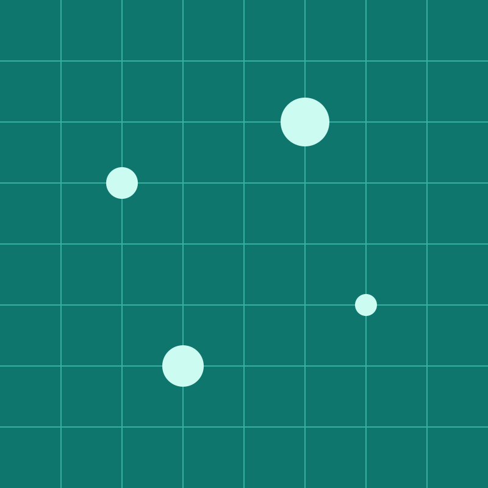

# Images and backgrounds

Everything on these slides is an SVG in `media/`.


---

## An inline image, sized


`` sets the width. `h:` sets the height.

---

## Filters

  

`grayscale`, `sepia` and `blur:4px`, as in Marp.

---



## A split background

```markdown

```

The image takes the right 40% (`left` takes the left) and the text flows into the rest.

---

<!-- _class: invert -->
<!-- _footer: "" -->
<!-- _paginate: false -->


## Several backgrounds

Two `![bg]` images share the slide side by side.

---


---

<!-- _footer: "" -->

## Attribution

`mark.svg`, `hills.svg` and `grid.svg` are original work of the go-slides
authors, released under [CC0 1.0](https://creativecommons.org/publicdomain/zero/1.0/).
You can reuse them without asking.
